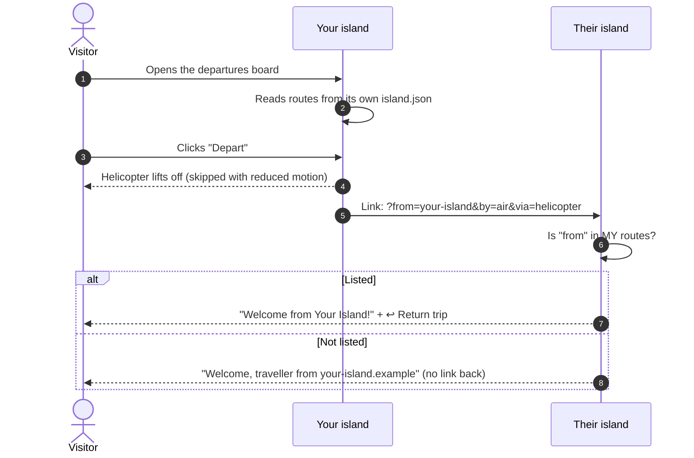
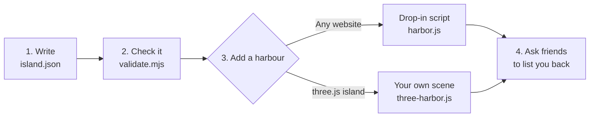
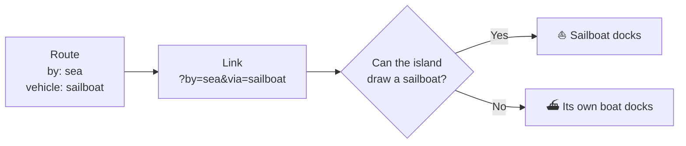

# Island Passport ✈️ ⛴️ 🚀

**Let illustrated "island" websites visit each other.**

Each site publishes a small `island.json` that lists the islands it travels to. A visitor picks a destination on a
departures board, a helicopter lifts off (or a ferry sails, a balloon floats up, a rocket launches), and they arrive on
the other island, which welcomes them and offers a trip home.

> Inspired by [HEART 政策島](https://puma.taipei/heart-island).

[正體中文 → README.zh-TW.md](README.zh-TW.md) · [Specification → SPEC.md](SPEC.md) · [JSON Schema](schema/island-passport.schema.json) · [Changelog](CHANGELOG.md)

---

## At a glance

| | |
|---|---|
| **What you add** | One file, `/island.json`, and one script tag (or your own three.js scene) |
| **How islands link** | Plain links with `?from=<your island>&by=<mode>&via=<vehicle>` |
| **Ways to travel** | Air, sea or space, with any vehicle: helicopter, jet, balloon, ferry, sailboat, rocket… |
| **Characters** | A visitor's character can travel along and go home again (optional) |
| **Privacy** | No requests to other sites on load, no tracking, nothing stored |
| **Dependencies** | None |

## How a trip works



A return link only appears when **both** islands list each other, so nobody can use an island to send people to an
address someone typed into a link.

## Get started



### 1. Write your passport

Put `island.json` at your site's root. Start from [`examples/minimal.json`](examples/minimal.json):

```json
{
  "passport": "1.3",
  "name": { "zh-Hant": "我的小島", "en": "My Island" },
  "url": "https://my-island.example/",
  "category": ["life", "art"],
  "routes": [
    {
      "url": "https://lighthouse-island.example/",
      "by": "air",
      "vehicle": "helicopter",
      "name": { "zh-Hant": "燈塔島", "en": "Lighthouse Island" },
      "category": ["health", "education"]
    }
  ]
}
```

Each route carries a **snapshot** (name, colour, categories) so your board never needs to fetch other islands.

### 2. Check it

```bash
node tools/validate.mjs island.json      # Node 18+, nothing to install
```

### 3. Add a harbour

**Any website.** Copy the `harbor/` folder into your site and add one line:

```html
<script type="module" src="/harbor/harbor.js" data-passport="/island.json"></script>
```

You get a ✈️ Routes button, a departures board, a departure animation and the arrival welcome.
Try it: `npm run demo`, then open <http://localhost:8766/examples/demo/>.

**A three.js island.** Use [`harbor/three-harbor.js`](harbor/three-harbor.js) for the vehicles and their paths, and
[`harbor/passport-core.js`](harbor/passport-core.js) for links and arrivals. Draw the board in your own style:

```js
import { readArrival, departUrl } from "./passport-core.js";
import { makeVehicle, arrivePath, Traveller } from "./three-harbor.js";

const a = readArrival(passport);                       // { from, by, vehicle, route, traveller } or null
if (a) {
  const v = makeVehicle(THREE, a.vehicle, {}, a.by);   // their vehicle, or yours for the same mode
  scene.add(v.group);
  trip = new Traveller(THREE, v.group, arrivePath(THREE, v.style, padOrDock, heading), { ms: 4000 });
}
```

### 4. Ask for routes back

Send your `island.json` address to the islands you link to. Once they list you, mark that route `"mutual": true`.

## Travel any way you like

`by` says **how** the traveller moves, so every island knows where to receive them. `vehicle` says **what** to
draw. An island that can't draw that vehicle uses its own one for the same mode.

| Mode (`by`) | Where they arrive | Suggested `vehicle` |
|---|---|---|
| ✈️ `air` | runway, helipad, balloon field | `plane` · `jet` · `helicopter` · `seaplane` · `balloon` · `airship` · `glider` |
| ⛴️ `sea` | harbour, pier | `boat` · `ferry` · `sailboat` · `speedboat` · `yacht` · `ship` · `canoe` · `submarine` |
| 🚀 `space` | launch pad | `rocket` · `ufo` |

Any other lowercase slug works too (`"vehicle": "dragon"`); islands that can't draw it fall back to the mode's
everyday vehicle (plane, boat, rocket).

There is no land travel: every island is surrounded by water, so you get there by air or by sea (or from space).



See [`examples/vehicles.json`](examples/vehicles.json) and [SPEC.md §9](SPEC.md#9-vehicles-12).

## Bring your character (1.1)

A small **traveller card** (name, skin, hair, outfit, accessories) can ride along after the `#` in the link, to
islands that accept one:

```json
{ "traveller": "1.0", "name": "Isla", "skin": "#E3B48C",
  "hair": { "style": "bun", "color": "#2B2320" }, "outfit": { "color": "#F3B9A5" }, "accessories": ["glasses"] }
```

- The next island **asks first**, then draws the character in its own style (nearest colours and hair styles).
- The return trip takes the character home as itself.
- Wheelchairs and canes travel only if the visitor ticks it. Age and health details never travel.

Islands say they accept cards with `"travellers": { "accept": true, "fields": [...] }`.
Details: [SPEC.md §8](SPEC.md#8-traveller-cards-11) and [`schema/traveller-card.schema.json`](schema/traveller-card.schema.json).

## Privacy, in short

- Loading an island contacts **no other site**. The board is drawn from your own file.
- Only `from`, `by`, `via` and (if the visitor chooses) a character card pass between islands.
- Cards live in the `#` fragment, which never reaches a server.
- Nothing about travellers is stored or logged.

## Categories

`category` says what kind of island a site is, so boards can label and group destinations. Use one to five,
main one first:

`life` · `art` · `design` · `health` · `education` · `policy` · `government` · `culture` · `language` · `travel` ·
`food` · `tech` · `ai` · `science` · `reading` · `comics` · `games` · `music` · `community` · `business` ·
`portfolio` · `news` · `nature` · `kids`

Other lowercase slugs are fine. See [SPEC.md](SPEC.md#categories).

## With an AI agent

This repository is also an **agent skill**. [`SKILL.md`](SKILL.md) tells an agent how to look at your site, write
and validate the passport, add the harbour (drop-in or three.js) and test it.

| Tool | How |
|---|---|
| Claude Code | `git clone https://github.com/petuchen/island-passport ~/.claude/skills/island-passport`, then ask "add an Island Passport harbour to my site" |
| Claude (app) | Add the folder as a skill, or attach `SKILL.md` and `SPEC.md` to the chat |
| Other agents | Point them at `SKILL.md`; it is plain Markdown and the code has no dependencies |

## What's in this repo

| Path | What it is |
|---|---|
| [`SPEC.md`](SPEC.md) | The format, version 1.3 |
| [`schema/`](schema/) | JSON Schemas for passports and traveller cards |
| [`harbor/passport-core.js`](harbor/passport-core.js) | Links, arrivals, cards, vehicles, validation. No dependencies |
| [`harbor/harbor.js`](harbor/harbor.js) | Drop-in harbour for any website |
| [`harbor/three-harbor.js`](harbor/three-harbor.js) | three.js vehicles (helicopter, jet, balloon, ferry, sailboat, rocket…), paths and the `Traveller` animator |
| [`tools/validate.mjs`](tools/validate.mjs) | Command-line validator |
| [`tests/`](tests/) | `npm test` |
| [`examples/`](examples/) | Minimal, full and all-vehicles passports, a traveller card, and a demo page |
| [`directory/islands.json`](directory/islands.json) | Islands that speak Island Passport; add yours with a pull request |
| [`badge/`](badge/) | An "Island Passport" badge for your footer |
| [`SKILL.md`](SKILL.md) | Instructions for AI agents |

## Contributing

Ideas for the format, new categories, vehicle models and fixes are welcome as issues or pull requests. Format
changes follow [SPEC.md §6](SPEC.md#6-versioning): `1.x` versions only add optional fields.

## License

MIT, see [LICENSE](LICENSE). The spec text may be copied and adapted freely.
