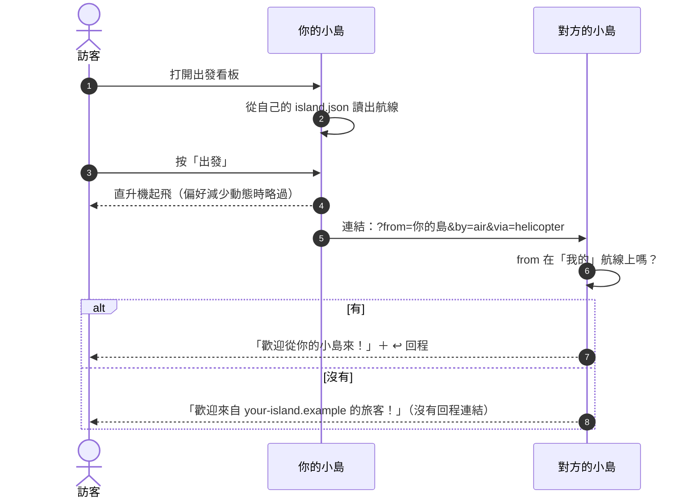
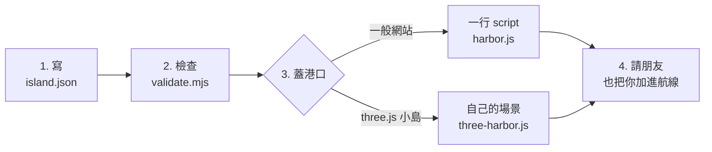
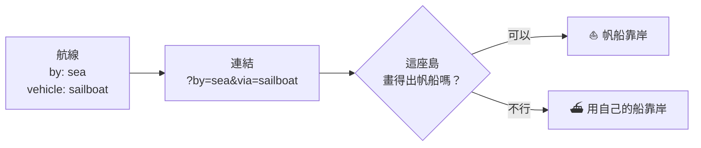

# Island Passport 小島護照 ✈️ ⛴️ 🚆 🚀

**讓插畫風「小島網站」互相拜訪。**

每個網站放一個小小的 `island.json`，寫下自己會去哪些小島。訪客在出發看板上選一個目的地，直升機起飛（或渡輪出港、火車出站、
火箭發射），就抵達對方的小島；對方會歡迎他們，也提供回程。

> 靈感來自 [HEART 政策島](https://puma.taipei/heart-island)。

[English → README.md](README.md) · [規格 SPEC.md](SPEC.md) · [JSON Schema](schema/island-passport.schema.json) · [更新紀錄](CHANGELOG.md)

---

## 一眼看懂

| | |
|---|---|
| **要加什麼** | 一個檔案 `/island.json`，加一行 script（或用你自己的 three.js 場景） |
| **小島怎麼連** | 一般連結，帶上 `?from=<你的島>&by=<方式>&via=<交通工具>` |
| **怎麼旅行** | 空路、海路、陸路或太空，交通工具隨你：直升機、噴射機、熱氣球、渡輪、帆船、火車、公車、火箭… |
| **角色** | 訪客的角色可以一起旅行，也能帶回家（選用） |
| **隱私** | 載入時不連到其他網站、不追蹤、不儲存任何資料 |
| **相依套件** | 沒有 |

## 一趟旅程怎麼進行



兩座島**都**把對方列進航線，才會出現回程連結；這樣別人就沒辦法拿你的島，把訪客導向任意網址。

## 開始使用



### 1. 寫護照

在網站根目錄放 `island.json`，可以從 [`examples/minimal.json`](examples/minimal.json) 開始：

```json
{
  "passport": "1.2",
  "name": { "zh-Hant": "我的小島", "en": "My Island" },
  "url": "https://my-island.example/",
  "category": ["life", "art"],
  "routes": [
    {
      "url": "https://lighthouse-island.example/",
      "by": "air",
      "vehicle": "helicopter",
      "name": { "zh-Hant": "燈塔島", "en": "Lighthouse Island" },
      "category": ["health", "education"]
    }
  ]
}
```

每條航線都附上對方的**資料快照**（名字、顏色、類別），所以你的看板不用去讀別的島。

### 2. 檢查

```bash
node tools/validate.mjs island.json      # Node 18 以上，不用安裝套件
```

### 3. 蓋港口

**一般網站**：把 `harbor/` 資料夾複製到網站裡，加一行：

```html
<script type="module" src="/harbor/harbor.js" data-passport="/island.json"></script>
```

就會有「✈️ 航線」按鈕、出發看板、出發動畫和抵達歡迎。試試看：`npm run demo`，打開 <http://localhost:8766/examples/demo/>。

**three.js 小島**：交通工具和路線用 [`harbor/three-harbor.js`](harbor/three-harbor.js)，連結和抵達用
[`harbor/passport-core.js`](harbor/passport-core.js)，看板用你自己的風格畫：

```js
import { readArrival, departUrl } from "./passport-core.js";
import { makeVehicle, arrivePath, Traveller } from "./three-harbor.js";

const a = readArrival(passport);                       // { from, by, vehicle, route, traveller } 或 null
if (a) {
  const v = makeVehicle(THREE, a.vehicle, {}, a.by);   // 對方的交通工具，畫不出來就用你同一種方式的
  scene.add(v.group);
  trip = new Traveller(THREE, v.group, arrivePath(THREE, v.style, padOrDock, heading), { ms: 4000 });
}
```

### 4. 請朋友加你

把你的 `island.json` 網址傳給你連過去的小島。對方把你加進航線後，在那條航線寫 `"mutual": true`（雙向航線）。

## 想怎麼去都可以（1.2）

`by` 說**怎麼**移動，讓每座島知道要在哪裡迎接；`vehicle` 說要**畫什麼**。畫不出那種交通工具的島，就用自己同一種方式的交通工具。

| 方式（`by`） | 在哪裡抵達 | 建議的 `vehicle` |
|---|---|---|
| ✈️ `air` 空路 | 跑道、直升機坪、熱氣球場 | `plane` 飛機 · `jet` 噴射機 · `helicopter` 直升機 · `seaplane` 水上飛機 · `balloon` 熱氣球 · `airship` 飛艇 · `glider` 滑翔機 |
| ⛴️ `sea` 海路 | 港口、碼頭 | `boat` 船 · `ferry` 渡輪 · `sailboat` 帆船 · `speedboat` 快艇 · `yacht` 遊艇 · `ship` 郵輪 · `canoe` 獨木舟 · `submarine` 潛水艇 |
| 🚆 `land` 陸路 | 車站、公車站 | `train` 火車 · `tram` 電車 · `bus` 公車 · `car` 汽車 · `bicycle` 腳踏車 · `scooter` 機車 · `cablecar` 纜車 · `walk` 步行 |
| 🚀 `space` 太空 | 發射台 | `rocket` 火箭 · `ufo` 飛碟 |

其他小寫代碼也可以（`"vehicle": "dragon"`）；畫不出來的島會用那種方式的常見交通工具（飛機、船、火車、火箭）。



範例見 [`examples/vehicles.json`](examples/vehicles.json)，規格見 [SPEC.md §9](SPEC.md#9-vehicles-12)。

## 帶著角色旅行（1.1）

一張小小的**旅客卡**（名字、膚色、髮型、衣服、配件）可以放在連結的 `#` 後面，帶到接受旅客卡的小島：

```json
{ "traveller": "1.0", "name": "Isla", "skin": "#E3B48C",
  "hair": { "style": "bun", "color": "#2B2320" }, "outfit": { "color": "#F3B9A5" }, "accessories": ["glasses"] }
```

- 下一座島會**先問**訪客，再用自己的畫風畫出這個角色（最接近的顏色和髮型）。
- 回程時，角色會以原本的樣子回家。
- 輪椅、手杖只有訪客勾選才會帶上；年齡和健康資料從不傳送。

接受旅客卡的島在護照寫 `"travellers": { "accept": true, "fields": [...] }`。
細節見 [SPEC.md §8](SPEC.md#8-traveller-cards-11) 和 [`schema/traveller-card.schema.json`](schema/traveller-card.schema.json)。

## 隱私重點

- 載入小島時**不會連到任何其他網站**，看板只讀你自己的檔案。
- 小島之間只傳 `from`、`by`、`via`，以及訪客自己選擇帶上的旅客卡。
- 旅客卡放在 `#` 後面，伺服器看不到。
- 不儲存、不記錄任何旅客資料。

## 類別 category

`category` 說明這是什麼樣的島，讓看板可以標示、分組。寫一到五個，最主要的放第一個：

| 代碼 | 中文 | 代碼 | 中文 | 代碼 | 中文 | 代碼 | 中文 |
|---|---|---|---|---|---|---|---|
| `life` | 生活 | `art` | 藝術 | `design` | 設計 | `health` | 健康 |
| `education` | 教育 | `policy` | 政策 | `government` | 政府 | `culture` | 文化 |
| `language` | 語言 | `travel` | 旅行 | `food` | 美食 | `tech` | 科技 |
| `ai` | AI | `science` | 科學 | `reading` | 閱讀 | `comics` | 漫畫 |
| `games` | 遊戲 | `music` | 音樂 | `community` | 社群 | `business` | 商業 |
| `portfolio` | 作品集 | `news` | 新聞 | `nature` | 自然 | `kids` | 親子 |

也可以用表上沒有的代碼（小寫英文、數字、連字號）。

## 交給 AI 代理人

這個 repo 本身就是一個 **agent skill**：[`SKILL.md`](SKILL.md) 會告訴 AI 怎麼先看懂你的網站、寫好並檢查護照、蓋港口（一般網站或
three.js 都可以），最後測試。

| 工具 | 做法 |
|---|---|
| Claude Code | `git clone https://github.com/petuchen/island-passport ~/.claude/skills/island-passport`，然後說「幫我的網站加一個 Island Passport 港口」 |
| Claude（App） | 把這個資料夾加成技能，或把 `SKILL.md` 和 `SPEC.md` 附在對話裡 |
| 其他 AI 工具 | 請它讀 `SKILL.md`；內容是純 Markdown，程式碼也沒有相依套件 |

## Repo 裡有什麼

| 路徑 | 內容 |
|---|---|
| [`SPEC.md`](SPEC.md) | 格式規格，1.2 版 |
| [`schema/`](schema/) | 護照和旅客卡的 JSON Schema |
| [`harbor/passport-core.js`](harbor/passport-core.js) | 連結、抵達、旅客卡、交通工具、檢查。沒有相依套件 |
| [`harbor/harbor.js`](harbor/harbor.js) | 任何網站都能用的港口 |
| [`harbor/three-harbor.js`](harbor/three-harbor.js) | three.js 交通工具（直升機、噴射機、渡輪、帆船、火車、火箭…）、路線和 `Traveller` 動畫 |
| [`tools/validate.mjs`](tools/validate.mjs) | 命令列檢查工具 |
| [`tests/`](tests/) | `npm test` |
| [`examples/`](examples/) | 最小、完整、各種交通工具的護照範例，旅客卡範例，和示範頁 |
| [`directory/islands.json`](directory/islands.json) | 支援 Island Passport 的小島名錄，歡迎用 pull request 加入 |
| [`badge/`](badge/) | 可以放在頁尾的「Island Passport」徽章 |
| [`SKILL.md`](SKILL.md) | 給 AI 代理人的說明 |

## 參與

歡迎用 issue 或 pull request 提出格式想法、新類別、交通工具模型或修正。格式變更依照 [SPEC.md §6](SPEC.md#6-versioning)：
`1.x` 只會新增選用欄位。

## 授權

MIT，見 [LICENSE](LICENSE)。規格文字可以自由複製、改寫。
